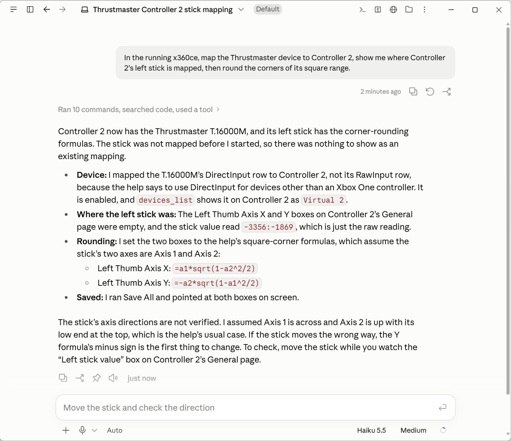
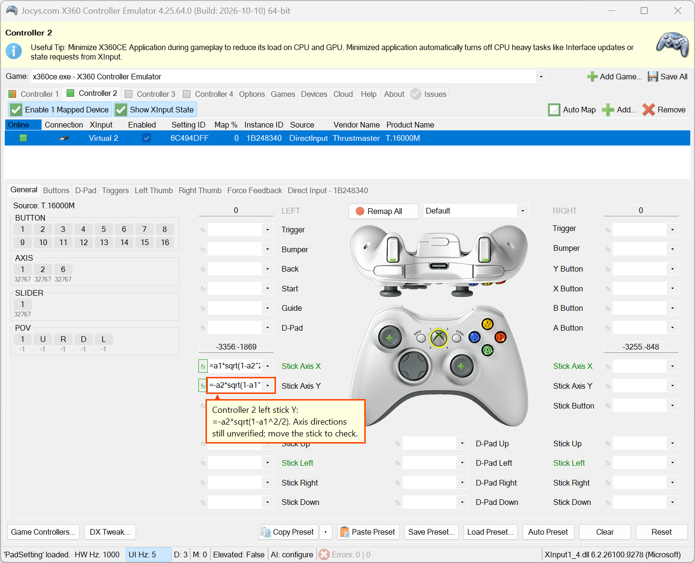

# AI assistants

An AI assistant can set up x360ce for you. You say what you want in plain words, and the assistant
works the program through its own AI assistant access. It never takes over your screen, mouse or
keyboard. You can watch each step, and the program writes each one down.

You do not have to use it. AI assistant access is off until you switch it on, and x360ce works the
same without it.

## Switch it on

1. Open the **Options** tab, then its **AI** page.
2. Tick **AI assistant access** and choose a level. **Read** only looks. **Configure** can do
   everything you do on the tabs, which is enough for mapping. **Administer** can also install
   drivers.
3. In the **AI skill** box, install the skill for your assistant: **Install for Claude Code**,
   **Install for other agents**, or **Save as ZIP** for the Claude app. The skill tells the assistant
   how to use x360ce.
4. Ask the assistant. An assistant that runs commands on this computer needs nothing more. Others
   connect as an MCP server, using the snippet or URL on the AI page.

[Help.v4](Help.v4.md#ai-assistant-access) explains the levels, both ways to connect and the token.
[The AI skill](Help.v4.md#the-ai-skill) says where each install goes.

## Try the example

The AI page shows an example request. **Copy example** puts it on the clipboard:

> In the running x360ce, map the Thrustmaster device to Controller 2, show me where Controller 2's
> left stick is mapped, then round the corners of its square range.

Change the device and the controller to your own. In this example, the assistant did the following:

1. It found the device by its maker. x360ce lists this Thrustmaster joystick as T.16000M.
2. It put the device's DirectInput row on Controller 2.
3. It found the left stick's boxes on Controller 2's General page.
4. It set them to the corner-rounding formulas from the help.
5. It saved, the same as **Save All**.
6. It framed the box on your screen, with a note beside it.

x360ce shows the assistant's work. The orange frame points at **Stick Axis Y** on Controller 2,
which now holds `=-a2*sqrt(1-a1^2/2)`. **Stick Axis X** above it holds `=a1*sqrt(1-a2^2/2)`.

## Check the stick yourself

An assistant cannot see which way your stick moves. That shows only while you move it. A good
assistant says so, as this one did.

1. Open the controller's **General** page.
2. Move the stick and watch the stick value box, the one above **Stick Axis X**. It shows across,
   then up.
3. Push up. The second number should go positive.
4. If up and down are swapped, remove the minus from the start of the Stick Y formula. Then
   press **Save All**.

## What keeps it safe

- The assistant can do only what the level you chose allows. The level is checked at every request.
  Untick AI assistant access, and every request is refused.
- **Open log** on the AI page lists every request: what was asked, what came of it, and when.
- To show you something, the assistant frames it on your screen. It never moves your mouse or types
  for you.
- Other computers cannot reach x360ce unless you open it to every network. Even then, they need the
  token on the AI page. A web page needs the token too, and a page from another site is always
  refused.

## More things to ask

- "List my controllers."
- "Why does my game not see my wheel?"
- "Where do I set the right stick's dead zone? Show me."
- "Make the triggers reach full at half a press."

The skill itself is published with the source, in
[skills/x360ce](https://github.com/x360ce/x360ce/tree/master/skills/x360ce).
