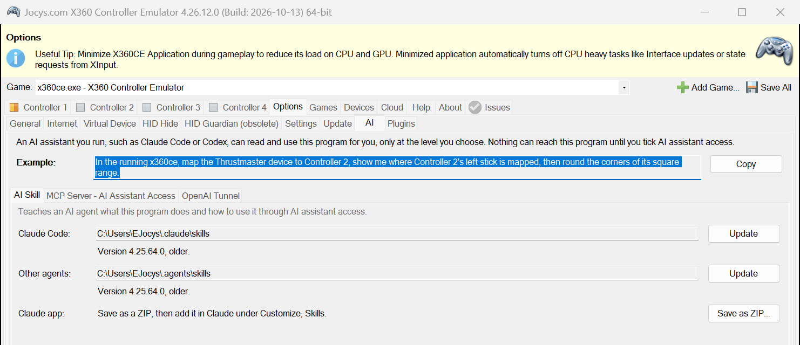
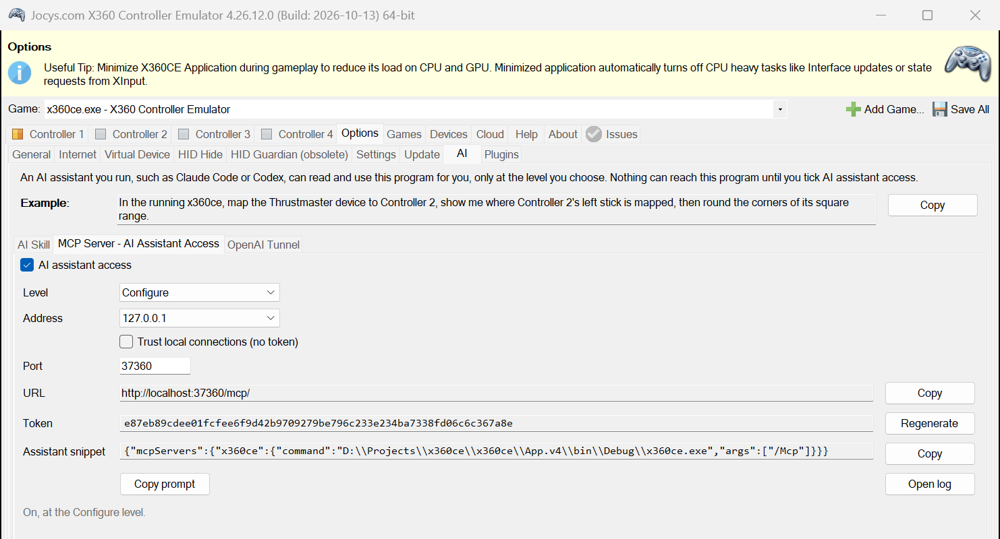
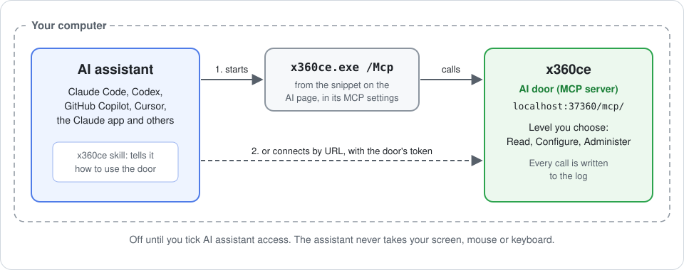
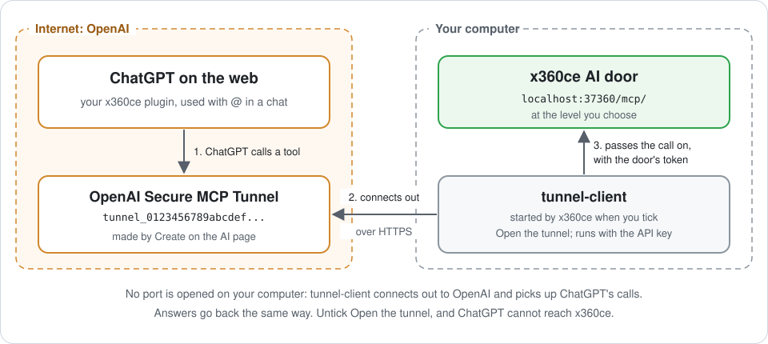
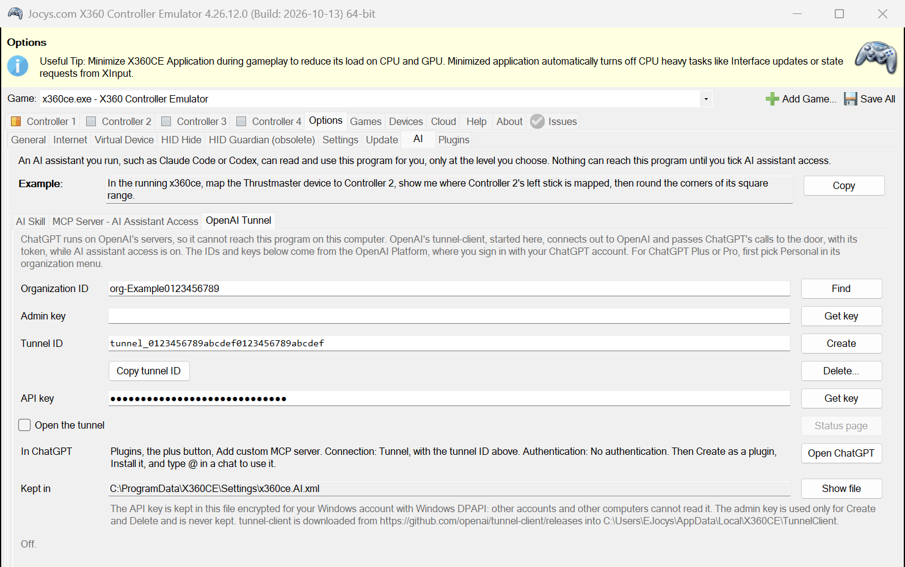

# AI assistants

> **x360ce has no AI inside.** This page is for people who want to use their own AI assistant, such as Claude, ChatGPT, Codex or Copilot, to set up x360ce. x360ce sends nothing to any AI service by itself. AI assistant access is off until you switch it on, and x360ce works the same without it.

With AI assistant access on, you say what you want in plain words, and the assistant works the program for you. It reads the pages, finds settings, changes them and points at them on your screen. It never takes over your screen, mouse or keyboard. You choose how much it may do, and the program writes down every step.

## AI use example

The AI page shows an example request at its top. **Copy** puts it on the clipboard:

> In the running x360ce, map the Thrustmaster device to Controller 2, show me where Controller 2's left stick is mapped, then round the corners of its square range.

Change the device and the controller to your own. In this example, the assistant did the following:

1. It found the device by its maker. x360ce lists this Thrustmaster joystick as T.16000M.
2. It put the device's DirectInput row on Controller 2.
3. It found the left stick's boxes on Controller 2's General page.
4. It set them to the corner-rounding formulas from the help.
5. It saved, the same as **Save All**.
6. It framed the box on your screen, with a note beside it.

x360ce shows the assistant's work. The orange frame points at **Stick Axis Y** on Controller 2, which now holds `=-a2*sqrt(1-a1^2/2)`. **Stick Axis X** above it holds `=a1*sqrt(1-a2^2/2)`.

## Check the stick yourself

An assistant cannot see which way your stick moves. That shows only while you move it. A good assistant says so, as this one did.

1. Open the controller's **General** page.
2. Move the stick and watch the stick value box, the one above **Stick Axis X**. It shows across, then up.
3. Push up. The second number should go positive.
4. If up and down are swapped, remove the minus from the start of the Stick Y formula. Then press **Save All**.

## More things to ask

- "List my controllers."
- "Why does my game not see my wheel?"
- "Where do I set the right stick's dead zone? Show me."
- "Make the triggers reach full at half a press."

## Set it up

Open the **Options** tab, then its **AI** page. The example is at the top. Below it are three tabs, in the order you set them up:

1. **AI Skill** teaches your assistant how to use x360ce.
2. **MCP Server - AI Assistant Access** lets the assistant in.
3. **OpenAI Tunnel** lets ChatGPT on the web in. Other assistants do not need it.

## AI Skill

The skill tells the assistant how to use x360ce. On the **AI Skill** tab, install it where your assistant reads skills:

- **Claude Code**: **Install** beside Claude Code.
- **Codex, GitHub Copilot, Gemini CLI, Cursor, OpenCode or Windsurf**: **Install** beside Other agents.
- **The Claude app**: **Save as ZIP**, then add the file in Claude under **Customize**, **Skills**.

[The AI skill](Help.v4.md#the-ai-skill) says where each install goes. The skill itself is published with the source, in [skills/x360ce](https://github.com/x360ce/x360ce/tree/master/skills/x360ce).

## MCP Server - AI Assistant Access

x360ce has an AI door: a Model Context Protocol (MCP) server inside the program. It listens only on this computer, at the level you choose.

1. On the **MCP Server - AI Assistant Access** tab, tick **AI assistant access** and choose a level. **Read** only looks. **Configure** can do everything you do on the tabs, which is enough for mapping. **Administer** can also install drivers.
2. Connect the assistant. **Copy prompt** copies everything it needs, both ways to connect included. Paste it into the assistant's chat.

An assistant on this computer reaches the door in one of two ways.

1. **An assistant that runs commands**, such as Claude Code, Codex, GitHub Copilot or Cursor. Paste the assistant snippet from this tab into its MCP settings. The assistant then starts `x360ce.exe /Mcp`, which passes its calls to the running program. It needs no token.
2. **An assistant that connects by URL.** Give it `http://localhost:37101/mcp/` with the header `Authorization: Bearer <token>`, where the token is the one on this tab. Which port reaches what: [Ports](Help.v4.md#ports).

ChatGPT on the web runs on OpenAI's servers, not on your computer, so it needs a tunnel. [OpenAI Tunnel](#openai-tunnel) below shows how to open one.

[Help.v4](Help.v4.md#ai-assistant-access) explains the levels, the address and the token.

## OpenAI Tunnel

ChatGPT on the web cannot reach the door on your computer by itself. The **OpenAI Tunnel** tab opens a way in. x360ce starts OpenAI's tunnel-client, which connects out to OpenAI and brings ChatGPT's calls to the door. Nothing on the internet connects to your computer.

The tunnel needs three things from the [OpenAI Platform](https://platform.openai.com/settings/organization/general), where you sign in with your ChatGPT account. For ChatGPT Plus or Pro, first pick **Personal** in the organization menu at the top left. Each box on the tab has a button that opens the right page.

| Box | Where to get it | Kept by x360ce |
|---|---|---|
| Organization ID | **Find** opens Settings, Organization, General. The ID starts with `org-`. | Yes. It is not a secret. |
| Admin key | **Get key** opens Admin keys. Make a new admin key. | No. It is used only to list, create and delete tunnels. |
| API key | **Get key** opens API keys. Create a new secret key, choose **Restricted**, and allow **Tunnels: Read** and **Use**. | Yes, encrypted for your Windows account. |

Then:

1. Switch on AI assistant access, as above.
2. Paste the **Organization ID** and the **Admin key**, then press **Create**. The **Tunnel ID** appears. If x360ce made a tunnel for this computer before, Create uses that one again instead of making another, so a ChatGPT plugin made with it keeps working.

   To use another tunnel, open the **Tunnel ID** list: with the admin key in its box, it shows the organization's tunnels, newest first, each with its description and the day it was made. Pick the one your ChatGPT plugin was made with. Only the admin key can list them; OpenAI lets no other key do it. You can also paste an ID, such as one made on the OpenAI Platform.
3. Paste the **API key** and tick **Open the tunnel**. After about 30 seconds the line at the bottom of the tab says **Open**.
4. In ChatGPT, go to **Plugins**. **Open ChatGPT** goes there. Press the plus button and choose **Add custom MCP server**.
   - **Connection**: **Tunnel**. Paste the tunnel ID, which **Copy tunnel ID** puts on the clipboard.
   - **Authentication**: **No authentication**. The tunnel adds the door's token to every call itself.
   - Tick **I understand and want to continue**, then press **Create as a plugin**.
5. **Install** the plugin on the **Personal** tab. In a chat, type `@` and pick it.

x360ce opens the tunnel again each time it starts, as long as both boxes stay ticked. **Status page** opens tunnel-client's own page, which shows whether ChatGPT's calls arrive. If ChatGPT says it gets no answer, look there first.

If ChatGPT says the x360ce connection is unavailable while the tab says **Open**, the plugin was most likely made with another tunnel, and no call reaches this one. Pick the plugin's tunnel in the **Tunnel ID** list, or give the plugin the ID the tab shows.

To shut ChatGPT out, untick **Open the tunnel**. **Delete...** removes the tunnel at OpenAI; it needs the admin key again.

## Where the keys are kept

| What | Where | How it is protected |
|---|---|---|
| AI settings: on or off, level, address, port, the door's token, the tunnel ID, the organization ID and the API key | `C:\ProgramData\X360CE\Settings\x360ce.AI.xml`. **Show file** on the OpenAI Tunnel tab shows it. | The API key is encrypted with Windows DPAPI for your Windows account. Other accounts and other computers cannot read it. The door's token is not encrypted: every account on this computer can read it. |
| Admin key | Nowhere | Used to list the tunnels, **Create** or **Delete**, then forgotten. |
| tunnel-client | `%LOCALAPPDATA%\X360CE\TunnelClient`, a folder for each release | Downloaded once from [github.com/openai/tunnel-client](https://github.com/openai/tunnel-client/releases). Used only when it matches the SHA-256 sum the release lists. |
| Log | `C:\ProgramData\X360CE\x360ce.AiAccess.log`. **Open log** on the MCP Server - AI Assistant Access tab opens it. | Lists every call, but never the token. |

If your settings are in another folder, or you started x360ce with `/Profile`, the AI settings file and the log are in that folder. **Regenerate** makes a new token, which shuts out anything that holds the old one.

## What keeps it safe

- The assistant can do only what the level you chose allows. The level is checked at every request. Untick AI assistant access, and every request is refused, the ones through the tunnel too.
- No assistant can change the AI page itself at any level: not the door, the level, the token or the tunnel. Only you can.
- **Open log** lists every request: what was asked, what came of it, and when.
- To show you something, the assistant frames it on your screen. It never moves your mouse or types for you.
- Other computers cannot reach x360ce unless you open it to every network. Even then, they need the token. A web page needs the token too, and a page from another site is always refused.
- ChatGPT reaches x360ce only through your own tunnel, only while **Open the tunnel** is ticked, and every call it passes on carries the door's token.
