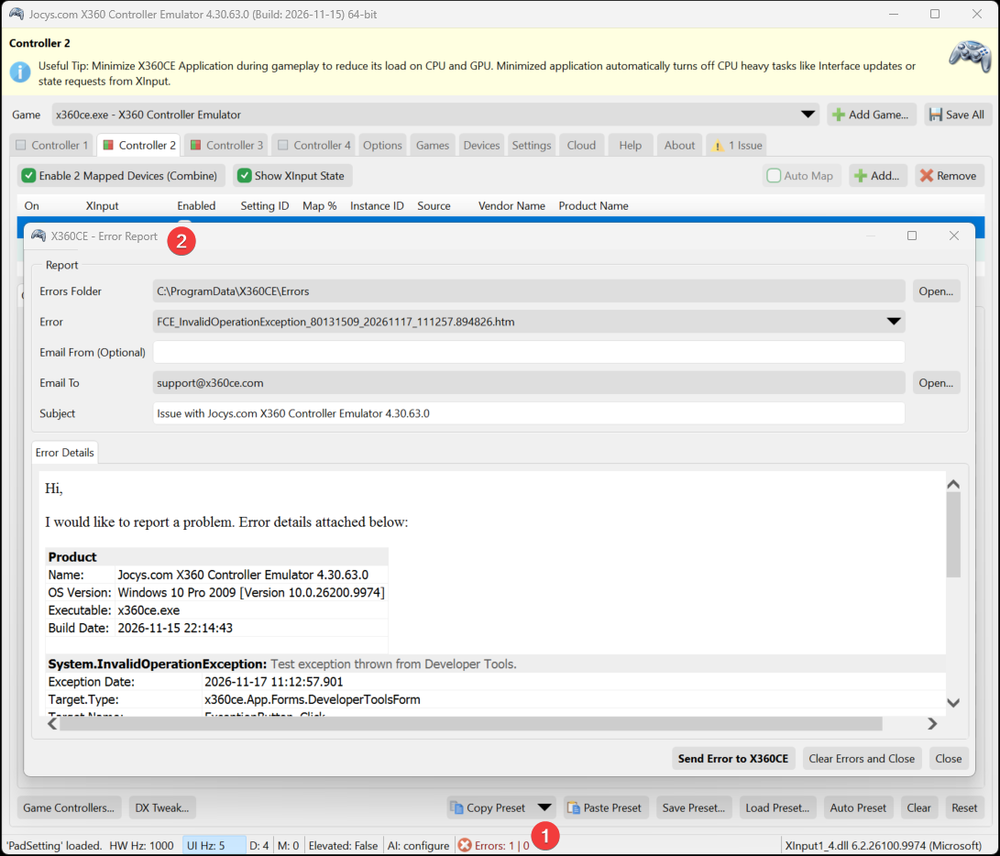
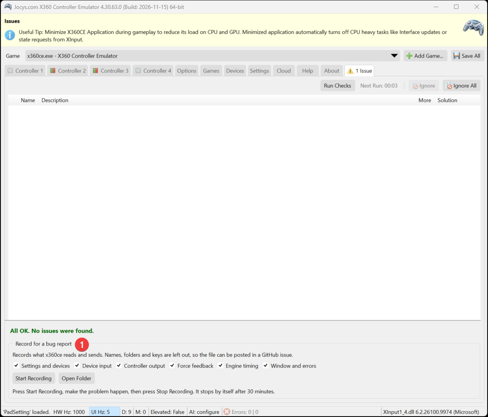
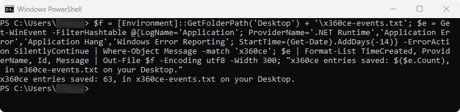

# Sending crash details when x360ce crashes or freezes

Use the step that matches what happened, then send what it gives you (step 5).

While x360ce runs:

- an error shows on the status bar: step 1;
- a controller is not mapped or does not work as it should: step 2.

When x360ce crashes or freezes:

- it closes by itself or stops responding: step 3, then step 4 if needed.

## 1. Send errors directly from x360ce

Use this step when x360ce reports an error on the status bar: **Errors** at the bottom of the window shows a number
above 0.

1. Click **Errors** on the status bar.
2. In the **X360CE - Error Report** window, click **Send Error to X360CE**.

   

x360ce sends the report itself: there is nothing to upload.

## 2. Record a problem with controller mapping

Use this step when x360ce runs, but a controller is not mapped or does not work as it should.

1. Open the **Issues** tab.
2. Under **Record for a bug report**, keep every box ticked and press **Start Recording**.
3. Make the problem happen, then press **Stop Recording**. It stops by itself after 30 minutes.
4. Press **Open Folder** to find the recording.

   

The recording leaves out names, folders and keys, so it can be attached to a GitHub issue as it is, or sent with step 5.

## 3. Save the crash entries from the Windows Event Log

Use this step when x360ce closes by itself or stops responding, with no error window.

1. Open the Start menu, type `PowerShell` and open **Windows PowerShell**.
2. Copy this line, paste it into the window with a right-click, and press Enter:

   ```powershell
   $f = [Environment]::GetFolderPath('Desktop') + '\x360ce-events.txt'; $e = Get-WinEvent -FilterHashtable @{LogName='Application'; ProviderName='.NET Runtime','Application Error','Application Hang','Windows Error Reporting'; StartTime=(Get-Date).AddDays(-14)} -ErrorAction SilentlyContinue | Where-Object Message -match 'x360ce'; $e | Format-List TimeCreated, ProviderName, Id, Message | Out-File $f -Encoding utf8 -Width 300; "x360ce entries saved: $($e.Count), in x360ce-events.txt on your Desktop."
   ```

3. It saves `x360ce-events.txt` on your Desktop and says how many entries it saved.

   

What will be included: the entries Windows wrote in the last 14 days that name x360ce, with the error and the place in
x360ce where it stopped. They can hold your Windows user name and folder names, so send them privately (step 5).

If it saved 0 entries, Windows has no note of the crash: make a memory dump (step 4).

**x360ce 3:** it runs inside the game, so put the game's program name in place of `'x360ce'` in the command, for
example `-match 'Game.exe'`.

## 4. Optional: Make a memory dump

Use this step only when the entries from step 3 do not explain the crash, or there are none.

1. Download ProcDump from Microsoft: https://learn.microsoft.com/sysinternals/downloads/procdump
2. Unzip it into a folder, for example `C:\ProcDump`.
3. Open that folder in File Explorer, click the address bar, type `cmd` and press Enter.
4. Make the folder for the dump: type `mkdir C:\x360ce-dumps` and press Enter. ProcDump does not make it.
5. Type the command for what happens, press Enter, and leave the window open:

   | When x360ce | Command |
   | --- | --- |
   | closes by itself | `procdump -accepteula -mm -e -w x360ce.exe C:\x360ce-dumps` |
   | freezes | `procdump -accepteula -mm -h -w x360ce.exe C:\x360ce-dumps` |
   | is frozen now | `procdump -accepteula -mm x360ce.exe C:\x360ce-dumps` |

6. Start x360ce, or wait for the crash. ProcDump saves a file that starts with `x360ce` and ends in `.dmp` in
   `C:\x360ce-dumps`.
7. Zip the dump, because it is too large to send as it is. Type this in the same window and press Enter:

   `tar -a -c -f C:\x360ce-dumps\x360ce-dump.zip -C C:\x360ce-dumps *.dmp`

   It saves `x360ce-dump.zip` beside the dump, about a quarter of its size: in a test, 28 MB became 7 MB. Or
   right-click the `.dmp` file and choose **Compress to** → **ZIP File**. Send the zip in step 5.

   

If ProcDump says "Multiple processes match the specified name", two copies of x360ce run: close one, or put the
**PID** of the one to dump, from Task Manager's **Details**, in place of `x360ce.exe`.

**x360ce 3:** use the game's program name in place of `x360ce.exe`, for example
`procdump -accepteula -mm -e -w Game.exe C:\x360ce-dumps`.

**Without ProcDump:** while x360ce is frozen, open Task Manager, go to **Details**, right-click `x360ce.exe` and choose
**Create memory dump file**. This file is much larger and holds more of your data.

## 5. Send the files privately

1. Email [support@x360ce.com](mailto:support@x360ce.com) and ask for a Request File upload link. Say what happened,
   and add the link to your GitHub issue if you opened one.
2. You get a link that starts with `https://www.x360ce.com/request/` followed by a code.
3. Right-click the file and choose **Compress to** → **ZIP File** (Windows 10: **Send to** → **Compressed (zipped)
   folder**).
4. Open the link and upload the zip.

Never attach the files from steps 3 and 4 to a GitHub issue: anyone can download them there.
