# GTA V Enhanced with a wheel and road feel

This guide sets up a Logitech G27, or a wheel like it, for GTA V Enhanced (`GTA5_Enhanced.exe`), and makes the
wheel feel the road from the game's telemetry. GTA V Legacy (`GTA5.exe`) works the same way. Do the steps in
order. They take about 15 minutes.

Steps 5 to 7 are optional. They give the wheel the feel of the road and the hits from the game's telemetry. Without
them, the wheel plays the game's own rumble.

To drive with telemetry, start story mode with **Play story mode** on the GTA V page. Start GTA Online from Steam as
usual: x360ce takes the mods out first.

Unzip x360ce into a folder of its own, such as `C:\Program Files\Jocys.com\x360ce`, and start `x360ce.exe` from there.
The steps name the folder of the Steam copy of the game, `c:\SteamLibrary\steamapps\common\Grand Theft Auto V Enhanced`.
Yours may be elsewhere.

## 1. Add the game

1. Open the **Games** tab.
2. Press **Add...**.
3. Choose `GTA5_Enhanced.exe` in the game's folder, such as
   `c:\SteamLibrary\steamapps\common\Grand Theft Auto V Enhanced`.
4. Select the game in the list.

   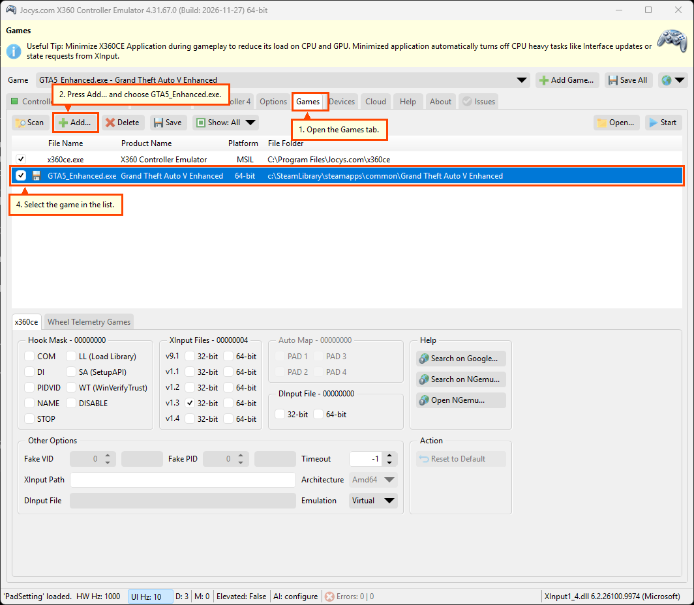

The **Game** box at the top now shows `GTA5_Enhanced.exe - Grand Theft Auto V`. Every setting below is kept for
this game alone.

## 2. Map the wheel and the pedals

1. Open the **Controller 1** tab.
2. Press **Add...**, select the wheel and press **Add Selected Device**.
3. Check that the wheel's row is ticked in **Enabled**.

   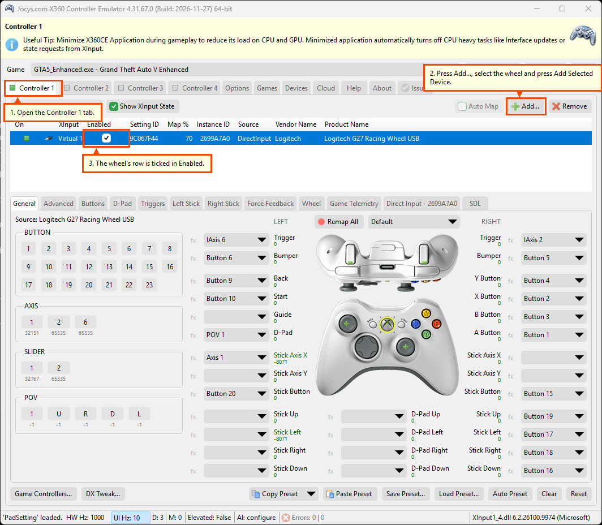

x360ce maps a G27 by itself: the wheel to the left stick, the gas pedal to the right trigger, the brake pedal to the
left trigger, and the buttons. To change a mapping, open the list beside its name on the **General** page.

### Steering

1. Open the **Left Stick** page.
2. In **X - Horizontal Axis**, open **Apply Preset** and choose `1% DeadZone, 100% Controller Anti-DeadZone`.

   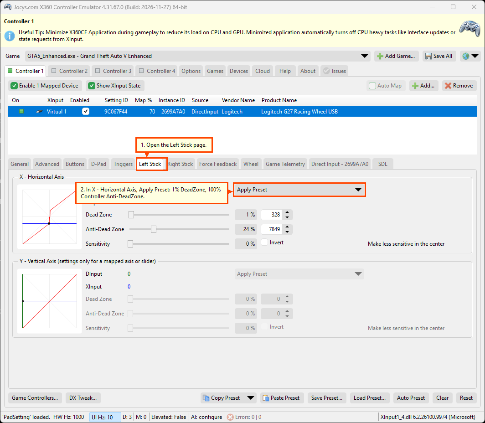

The car now answers the smallest turn of the wheel.

### Pedals

GTA V ignores the first part of a trigger's travel. **Anti-Dead Zone** skips that part, so the car answers the
lightest press.

1. Open the **Triggers** page.
2. In **Left Trigger** (the brake), set **Anti-Dead Zone** to 24 %: move the slider, or type `61` in the box beside
   it.
3. In **Right Trigger** (the gas), set it to 24 % too.

   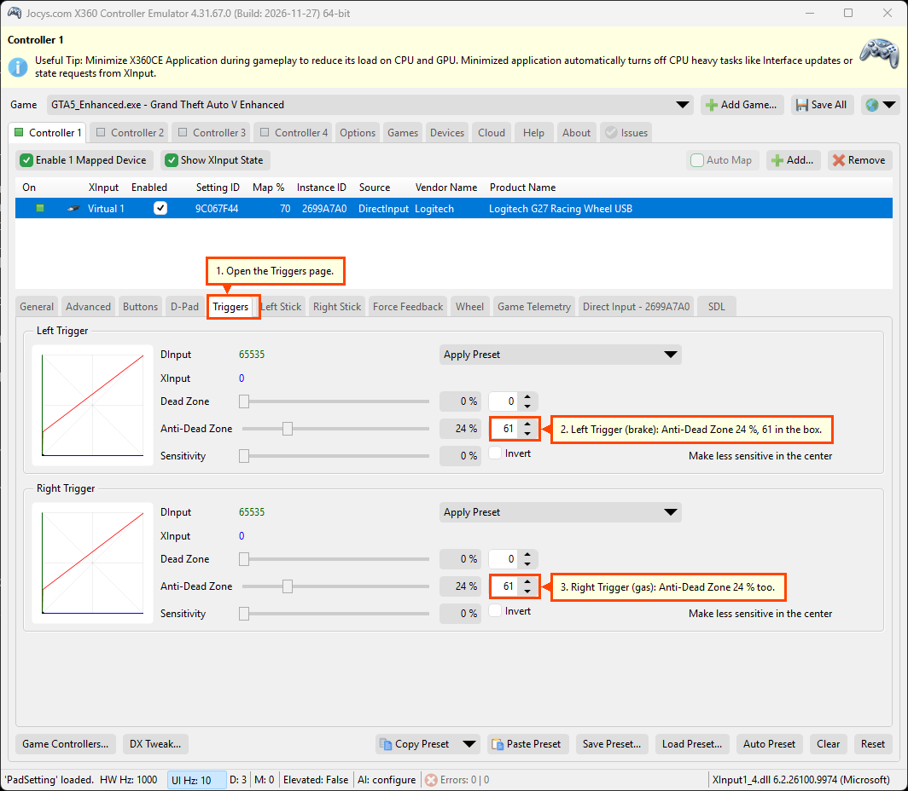

4. Later, in the game, stop the car and press the gas as lightly as you can.
   - The car does not move: raise **Anti-Dead Zone** by 2 % and try again.
   - The car jumps forward at the first touch: lower it by 2 %.
5. Do the same for the brake.
6. If the car creeps with both pedals released, raise **Dead Zone** to 1 %.

24 % is a starting value that is easy to remember. No exact figure for GTA V has been published, so check it with
step 4.

## 3. Set the wheel's range and centre

1. Open the **Wheel** page.
2. Tick **Centering spring**. The game's telemetry reaches the wheel only while it is ticked.
3. In **Car**, choose **Family car, 100 km/h (ISO 13674-1 weave test, measured)**.
4. In **Wheel range**, choose **900° - Road and sports cars**.
5. Press **Auto** with your hands off the wheel. The wheel turns to both stops and x360ce sets **Friction**.

   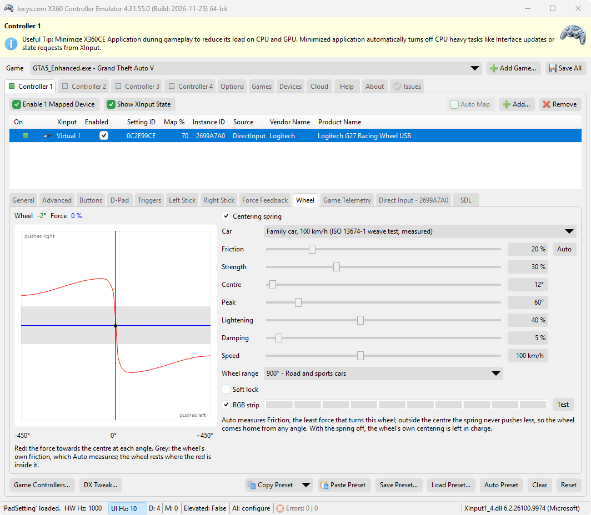

How the centering spring works: [How a real car centres its steering wheel](Help.WheelCentering.md).

## 4. Set force feedback

1. Open the **Force Feedback** page.
2. Tick **Enable**.
3. In **Effects Type**, choose **Constant**.

   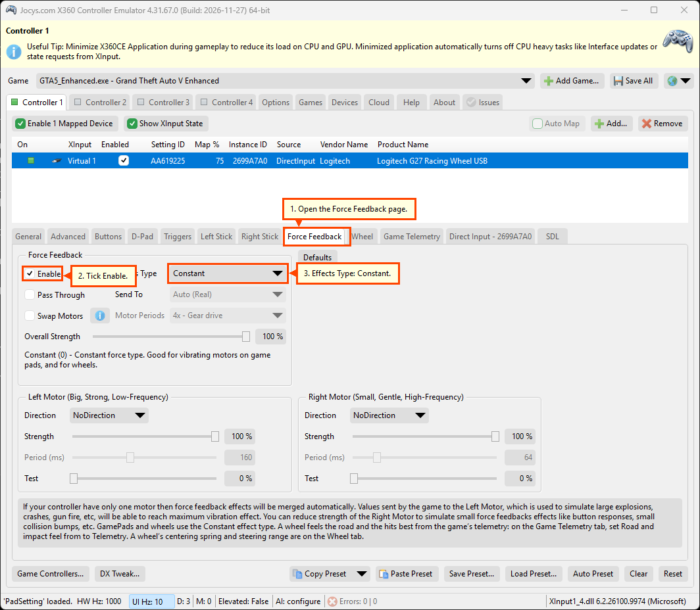

While telemetry arrives, the road and the hits come from telemetry, and the game's own rumble is not played. When no
telemetry arrives, the game's rumble plays. If it is too strong then, lower **Strength** under **Left Motor**.

## 5. Install the telemetry script (Optional)

1. Open the **Games** tab and select the game.
2. Under the list, open the **Wheel Telemetry Games** tab, then its **GTA V** page.
3. Read the three warnings, in yellow above the page's steps.

   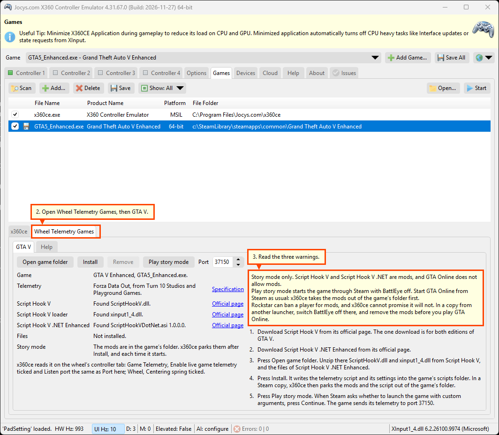

4. Press **Official page** beside **Script Hook V**. Download Script Hook V from
   [its official page](http://www.dev-c.com/gtav/scripthookv/).
5. Press **Official page** beside **Script Hook V .NET Enhanced**. Download it from
   [its official page](https://www.gta5-mods.com/tools/script-hook-v-net-enhanced).
6. Press **Open game folder**, at the top of the page. It opens the game's folder, such as
   `c:\SteamLibrary\steamapps\common\Grand Theft Auto V Enhanced`.
7. Unzip `ScriptHookV.dll` and `xinput1_4.dll` from Script Hook V into that folder.
8. Unzip the files of Script Hook V .NET Enhanced into the same folder.
9. Check that each mod's line on the page says **Found**.

   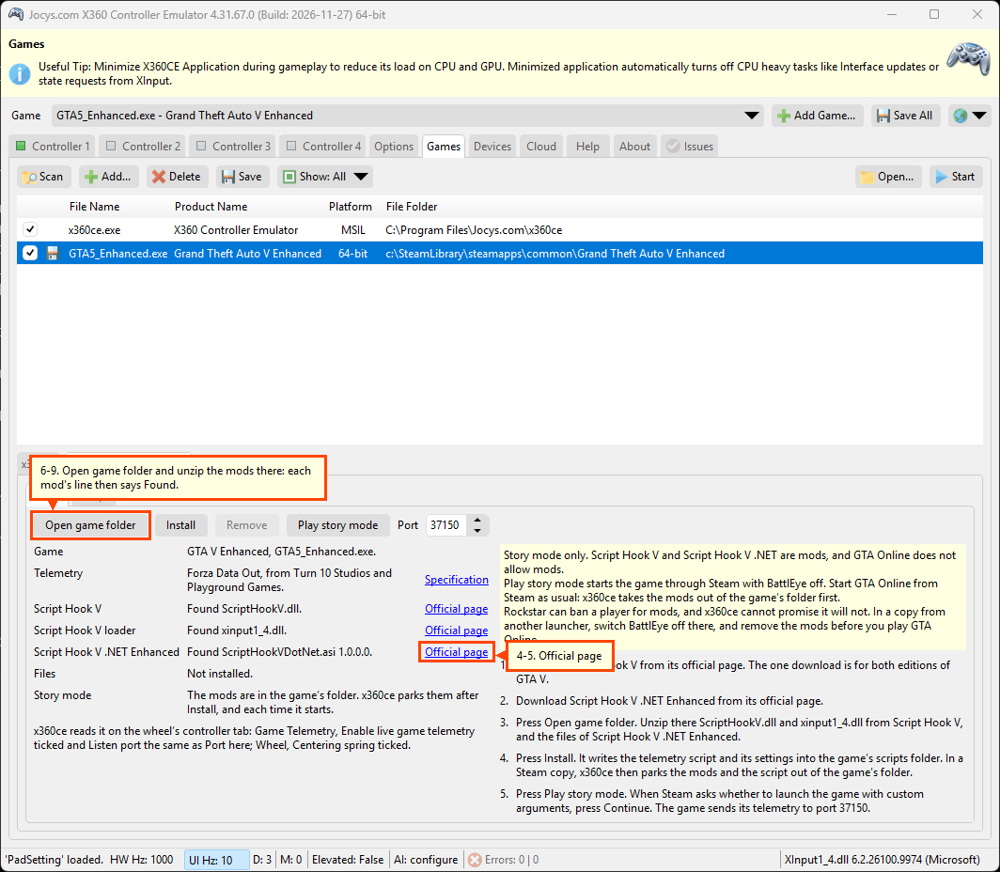

10. Leave **Port**, beside the buttons, at `37150`.
11. Press **Install**. It writes the telemetry script and its settings into the game's `scripts` folder.
12. x360ce then parks the mods and the script out of the game's folder. Each mod's line says **Parked**, and
    **Story mode** says where they are.

    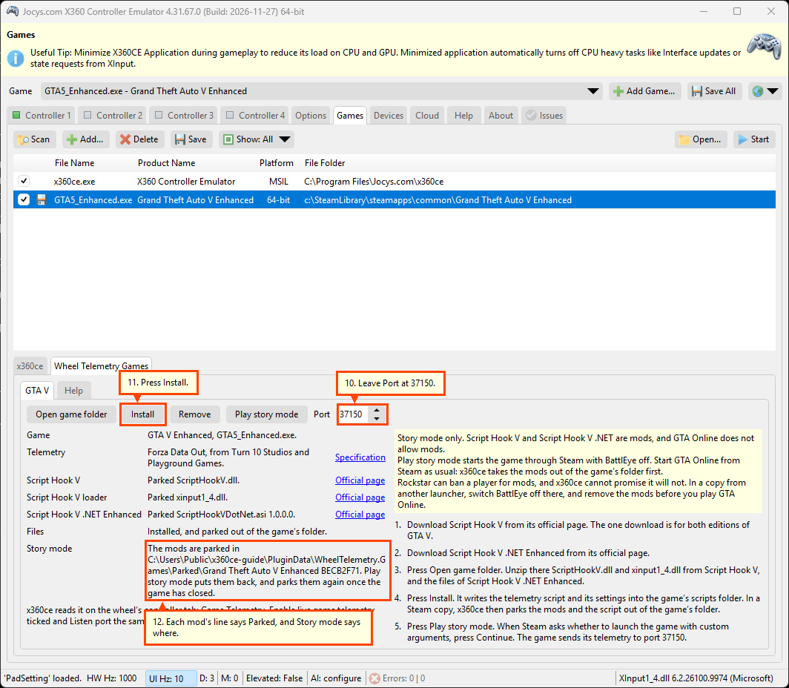

x360ce does not include or download the mods. For GTA V Legacy, the page names Community Script Hook V .NET 3
instead.

x360ce parks the files the page names: `ScriptHookV.dll`, its loader `xinput1_4.dll`, `ScriptHookVDotNet.asi` and
the telemetry script. Without the loader the game loads no mod, so the other files of Script Hook V .NET can stay. They
are parked in x360ce's settings folder, such as `C:\ProgramData\X360CE\PluginData\WheelTelemetry.Games\Parked`, not
in the game's folder. BattlEye checks what the game loads, and finds nothing there to load. Steam's **Verify integrity
of game files** checks only the game's own files. x360ce parks the mods again each time it starts while the game is
closed.

**Play story mode** needs the Steam copy of the game. For a copy from the Epic Games Store or the Rockstar Games
Launcher it is greyed: switch BattlEye off in that launcher for story mode, and take the mods out of the game's folder
before you play GTA Online. Rockstar can ban a player for mods, and x360ce cannot promise it will not.

If the **Wheel Telemetry Games** tab is missing, open **Options**, then **Plugins**, and check that the
**WheelTelemetry.Games** row is ticked in **Enabled**.

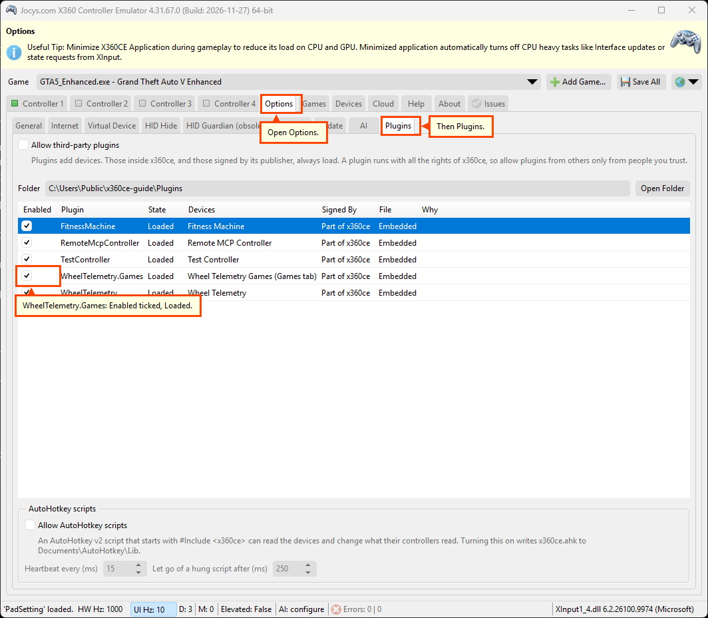

## 6. Set the road feel (Optional)

1. Open **Controller 1**, then the **Game Telemetry** page.
2. Keep **Enable live game telemetry** ticked.
3. Keep **Listen port** at `37150`.
4. In **Road and impact feel from**, choose **Telemetry**.
5. To feel kerbs harder or softer, move **Curb bumps**.
6. Press **Save All** at the top.

## 7. Check that telemetry arrives (Optional)

1. On the **GTA V** page, press **Play story mode**, at the top. x360ce puts the mods back and has Steam start the
   game with `-nobattleye`, which switches BattlEye off.

   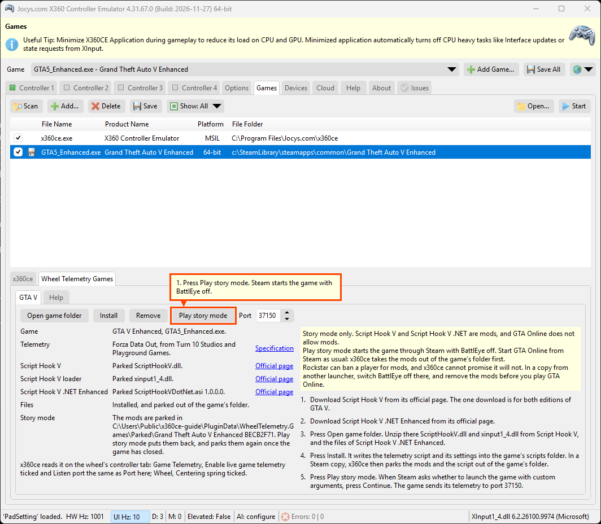

2. Steam asks whether to launch the game with custom arguments. Press **Continue**.
3. Load story mode and drive a car.
4. Look at **Live Telemetry** on the **Game Telemetry** page.

   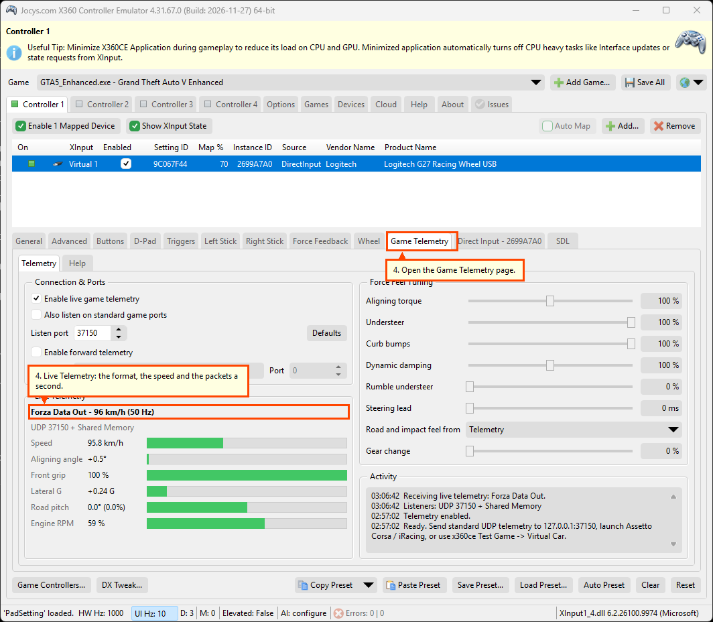

The first line names the format, the speed and the packets a second, such as `Forza Data Out - 97 km/h (50 Hz)`.
GTA V's script sends its telemetry in Forza's format. **Waiting for game telemetry...** means nothing arrives yet:
see [Troubleshooting](#troubleshooting).

When the game closes, x360ce parks the mods again. If the game has not started five minutes after you pressed **Play
story mode**, x360ce parks them too: press it again.

The lights on the wheel show the engine's revs:

- Below half revs, they are off.
- As the revs rise, the lights come on in pairs, from green at both ends to red in the middle.
- All the lights flash at the rev limit: time to shift up.

GTA V shifts gears by itself, at about the moment every light is lit. The lights show only the revs. They do not
say whether the gear is the best one.

## 8. Record a report

When something feels wrong, record it and attach the file to a GitHub issue:
[Record a problem with controller mapping](Help.CrashDetails.md#2-record-a-problem-with-controller-mapping).
Drive while it records, so the recording holds the telemetry and the forces.

## Troubleshooting

**The wheel turns only 270° in the game.** Logitech's software sets its own range when the game comes to the front.
x360ce sends 900° again at once. If the range stays at 270°, choose **900° - Road and sports cars** in **Wheel
range** again, or set 900° in the wheel's own software.

**Nothing arrives.**

- Check that the line under the status on the **Game Telemetry** page names port 37150, and that no other program
  holds it.
- After a game update, Script Hook V works only once its own update for that game version is out. Download it again.
- Script Hook V .NET writes `ScriptHookVDotNet.log` in the game's folder. An error about `x360ce.Telemetry.3.cs` there
  says why the script did not start.

**The shift lights stay dark.** Tick **RGB strip** on the **Wheel** page. The lights follow the engine's RPM from
telemetry, so they light only while telemetry arrives. Press **Test** beside them to check the lights without the
game.

**The wheel kicks at each gear change.** The game's own rumble is playing. Choose **Telemetry** in **Road and impact
feel from**. If you choose **Both** or **Game**, set **Gear change** to 0 %.

**The car does not move until the pedal is half down.** Check that the gas and the brake are separate pedals: see
[Gas and brake pedals are combined](Help.v4.md#gas-and-brake-pedals-are-combined-how-can-i-separate-them). Then
set **Anti-Dead Zone** again, as in [Pedals](#pedals).

**To remove the mods.** On the **GTA V** page, press **Remove**. It deletes the telemetry script and puts the parked
mods back into the game's folder. Then delete from the game's folder `ScriptHookV.dll`, `xinput1_4.dll` and the files
of Script Hook V .NET Enhanced.
