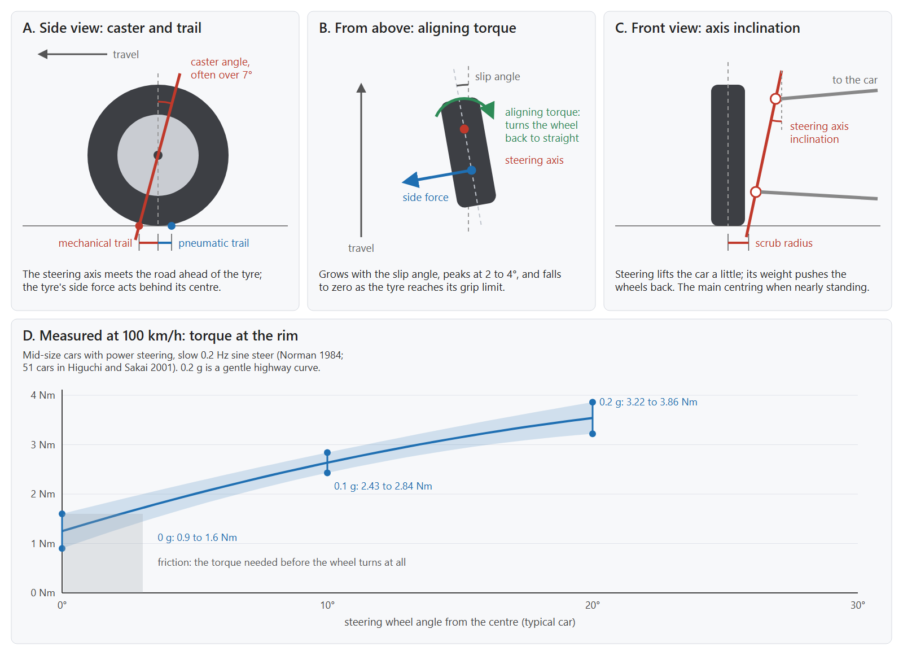

# How a real car centres its steering wheel

A game made for a gamepad sends no steering force, so x360ce's centering spring has to stand in for the car. This page
says what holds a real car's wheel at the centre, how strong it is, which standards measure it, and the settings on
x360ce's Wheel tab that copy it.

## The short answer

- **No standard sets how a steering wheel must feel.** The ISO standards for steering say how to *measure* it, so
  cars can be compared. Each car maker tunes its own feel, and the measured values differ widely from car to car.
- **What every car shares is the physics.** The wheel is pulled back by springs: the tyres' aligning torque at speed,
  and the car's own weight when it is slow. They grow as the wheel turns from the centre.
- **Damping is not what centres the wheel.** In the measurements below, more damping only made the wheel lag behind
  the car, which drivers feel as a heavier steering. Electric power steering keeps it low while the wheel turns
  slowly, so the centre does not feel sticky.

## Where the centring comes from

### 1. Caster and trail (picture A)

The steering axis leans back, so it meets the road ahead of the tyre's centre: the **mechanical trail**. Caster
angles over 7° are common on cars with radial tyres. A castor wheel on a shopping trolley follows its pivot for the
same reason.

### 2. Aligning torque from the tyres (picture B)

A turning tyre is twisted slightly against its direction of travel: the **slip angle**. Its side force does not act
at its centre but behind it, by the **pneumatic trail**. Both trails together are the lever the side force pulls the
wheel back to straight with. This is the **aligning torque**, and it is what the driver feels at speed.

- It grows with the slip angle and **peaks at about 2 to 4°** of slip.
- Past the peak, the pneumatic trail collapses and the torque **falls to zero at the grip limit**. The steering
  "goes light", which is how a driver feels the front tyres losing grip.
- At a given angle of the wheel it grows with speed. In a study of steering feel for a steer-by-wire car, the
  stiffness of the wheel rose about in proportion to speed: designed at 0.12 Nm per degree at 40 km/h (0.11 measured
  on the road) and 0.37 Nm per degree at 97 km/h.

### 3. Steering axis inclination (picture C)

Seen from the front, the steering axis also leans inwards. Turning the wheel then lifts the front of the car a
little, and the car's weight pushes the wheels back to straight. This **jacking torque** gives most of the centring
when the car is slow or standing, when the tyres give almost none.

### 4. Friction, power assist and damping

- **Friction** in the rack and column has to be overcome before the wheel turns at all: about **0.9 to 1.6 Nm** at
  the rim. The wheel rests wherever the spring falls below it, which is why a car's wheel comes back near the centre
  rather than exactly to it.
- **Power steering** helps the driver turn, so only part of the tyres' torque reaches the hands. Electric power
  steering adds its own **active return**, to bring the wheel back against the friction, and **active damping**, to
  stop the wheel overshooting the centre at speed.
- **Damping** comes from the rack, the column and the power steering. In the steer-by-wire study, raising it changed
  one measure only: returnability, how much the car still turns when the driver lets go. More damping means more
  lag, a heavier feel. One electric power steering design scales its damping with how fast the wheel turns, low
  when slow, so the centre does not feel sticky.

## What the measurements say

The standard on-centre test is a slow weave: 100 km/h, a sine steer at 0.2 Hz, just enough for 0.2 g of sideways
acceleration. That is a gentle highway curve, about 20° of the wheel. ISO 13674-1 standardises it as the weave test.

| Measure | Norman, 1984 | Higuchi and Sakai, 2001 (51 cars) | What it tells |
| --- | --- | --- | --- |
| Torque at 0 g | 0.9 Nm | 1.6 Nm | Friction: the torque before the wheel turns at all |
| Torque gradient at 0 g | 20 Nm/g | 20.8 Nm/g | How clearly the centre is felt |
| Torque at 0.1 g, about 10° | 2.43 Nm | 2.84 Nm | The effort of a gentle curve |
| Torque gradient at 0.1 g | 7.9 Nm/g | 10.2 Nm/g | Softer just off the centre than on it |

Ranges measured on many cars in the same test at 97 km/h:

| Measure | Range | What it tells |
| --- | --- | --- |
| On-centre feel | 7 to 33 Nm/g | The torque gradient on the centre: light to heavy cars |
| Sensitivity | 0.27 to 1.42 g per 100° | How much the car turns for the wheel's angle: slow to quick steering |
| Returnability | 0.01 to 0.13 g | How far the car still turns when the hands let go: more damping, more lag |

So a real car's force is **steep on the centre and softer further out**. It is never the same at every angle.

## The standards

| Standard | What it does |
| --- | --- |
| ISO 13674-1 | Road vehicles, on-centre handling: the weave test above (third edition, 2023). |
| ISO 13674-2 | The other part of on-centre handling: the transition test (2016, confirmed 2021). |
| ISO 17288-1 | Passenger cars, free-steer behaviour: how the car behaves when the driver lets go of the wheel in a steady curve (2011, confirmed 2023). |
| ISO 17288-2 | The same, with a short steering pulse. |
| UN Regulation No. 79 | The legal steering rules in Europe and elsewhere: the most force a driver may need, with the steering intact and after a failure. Not how it feels. |

These standards define tests and words, not target values. That is why two cars that both pass them can feel very
different, and why copying "the standard" cannot give one correct feel. What can be copied is the shape the tests
measure, with the values of a kind of car.

## One centring for every game

x360ce cannot feel the car's speed: a game made for a gamepad sends only rumble. So the centring is one curve, chosen
with the kind of car and a speed you set, and it stays the same while you drive. The rumble the game sends is played on
top of it, as it is now.

### The curve

The force towards the centre has two parts. The first is **Friction**: the least force that turns the wheel, the
same at every angle but the last few degrees before the centre, so the wheel comes home from any angle, as a car's
active return brings its wheel back against
the friction in the rack. The second, on top of it, is the car's steering, drawn through four points, and a smooth
curve joins them without rising or falling anywhere more than the points do:

1. Nothing at the centre.
2. Half of the peak at **Centre**.
3. The full **Strength** at **Peak**.
4. **Lightening** of it left at the stop.

Within a fifth of a percent of the travel from the centre, 1.8° on a 900° wheel, there is no force at all, so the
wheel can rest there. Outside it the force, Friction too, rises no steeper than the wheel can follow (see below), so
on a G27 it reaches Friction about 9° out, and the wheel slows as it comes in instead of being thrown across the
centre. The other side of the centre is its
mirror. The angles are the steering wheel's, counted against **Wheel Range**. No wheel says what range it turns,
so the spring needs one chosen: ticking it with the range left as it is picks 900°, which a Logitech wheel is sent.
On any other wheel, choose the range its own software sets. Counted against a wider range than the wheel turns,
the spring is steeper than set, and the wheel swings at its centre. Settings saved with both are counted against
200° on a Logitech wheel, the range it powers up at, and against 900° on any other.

### Speed

The four points describe the car at 100 km/h, the speed of the ISO 13674-1 weave test the measurements come from. A
car's wheel gets stiffer about in proportion to its speed, so at another **Speed** the curve is read at the angle
scaled by it:

> force at an angle = Friction + Strength × the curve at (angle × speed ÷ 100)

At 40 km/h the force builds over two and a half times the angle; at 10 km/h over ten times, an even, soft pull, as
when parking. Below 10 km/h the steering axis inclination still pulls the wheel back, so 10 km/h is the least the
formula uses.

The speed is a setting. Beside it the program keeps a live speed, never saved, which replaces the setting whenever
something sets it; nothing sets it yet. Something that knows the car's real speed can fill it later. That cannot be
the game's force feedback:
the emulated controller receives two motor values of 8 bits each, and both are the rumble the game plays. A racing
game's own telemetry, which many games publish over the network or in shared memory, could be read by a small
program that sets the live speed through x360ce's AI assistant access or its remote UDP server.

### The chart on the Wheel tab

The Wheel tab of each controller shows the curve as the thumb stick pages show theirs: the angle across, from one
stop to the other, and the force up and down, above the middle for a push to the right. The red curve is drawn again
as each slider moves, and the crosshair and the dot follow the wheel as it turns, so you see the force at the angle
you hold. The grey band is Friction, forces too weak to turn the wheel. The curve stays above it everywhere but a few
degrees round the centre, where it rises gently, so the wheel comes home from any angle and settles there without
shaking.

On a Logitech G27 at 900°, 26 % of the wheel's force brings it home from either stop, so Auto sets Friction to 29 %,
and the family car's Strength of 30 % comes on top of it. Let go at either stop, the wheel was back inside Centre in
about 1.2 s, crossed the centre twice, and came to rest within 1° of it.

### Can the wheel hold this shape by itself?

No. DirectInput gives a wheel four effects it plays on its own, in its own electronics, smoothly and without the
computer: a spring, a damper, friction and inertia. Its spring is a straight line from the centre, at its steepest
reaching full force only at the far edge, and it can be cut off flat. It cannot be steep on the centre, reach a peak
and fall again.

- At its steepest, on a 900° wheel, the spring adds 0.22 % of the wheel's force per degree. The family car below
  needs half of a 60 % peak within 12°: 2.5 % per degree, eleven times steeper.
- So the shape is played by x360ce. Its engine reads the wheel up to 1000 times a second and sets one constant force
  from the curve, as the centering spring does now. The force is sent only when it changes by a step, so a turning
  wheel gets a few hundred updates a second and a still one gets none.
- Damping and friction stay on the wheel, as DirectInput damper and friction effects, which it computes itself.
- The limit is time. The force follows the wheel a few milliseconds late, and a curve that is too steep on the centre
  makes the wheel chase its own force: on a G27, a nine-times-a-second shake. x360ce caps how steep the curve may be
  near the centre and widens Centre when it has to, and the chart shows the curve as it is played. The cap holds for
  Friction too: a jump to Friction at the edge of the dead band shook a G27 four degrees either side, five times a
  second.

So the shape can be copied, and the force in newton metres only as far as the wheel can make it: Friction lifts the
curve over the wheel's own friction, and Strength scales the car's part to the wheel. The change with speed is copied only as far as the speed is known.

## The settings on the Wheel tab

The settings follow the measures above, in the units x360ce can use: angles of the wheel and percentages of the
wheel's force.

| Setting | What it sets | Car measure it copies |
| --- | --- | --- |
| **Car** (list) | Fills in the settings below and Wheel Range, and names what each car is based on | The kind of car, its speed and its lock to lock |
| **Friction** | The least force outside the centre, in percent of the wheel's force; 20 % until Auto measures it, and kept with the wheel | Active return against the friction in the rack |
| **Strength** | The car's force at the peak, on top of Friction, in percent of the wheel's force; nought turns the spring off | Peak aligning torque |
| **Centre** | The angle at which the force reaches half its peak, at 100 km/h | On-centre feel and torque gradient |
| **Peak** | The angle of the strongest force at 100 km/h; beyond it the wheel goes lighter | The tyres' peak slip angle |
| **Lightening** | How much of the force is left at the stop | Aligning torque falling past the grip limit |
| **Damping** | A small resistance to the wheel's speed, at every angle | Returnability; the light damping of power steering |
| **Speed** | The car's speed the curve is read at | Stiffness growing with speed |

In the model and the database these are one group, named with the prefix of the two that already exist there:
`ForceSpringEnable`, `ForceSpringStrength`, and the new `ForceSpringCentre`, `ForceSpringPeak`,
`ForceSpringLightening`, `ForceSpringDamping` and `ForceSpringSpeed`. The car itself is not stored: the list shows
the car the values match, or Custom. The family car at 100 km/h is also the default: a setting that leaves these
values empty gets it, and a value equal to it is stored empty, so settings saved before keep their checksums.
Friction belongs to the wheel, not the car, so it is kept with the device as `ForceSpringFriction`, for every car and
every controller tab the wheel is on. It starts at 20 %, which brings even a geared wheel home from its stops, and
20 % is stored as nought, so devices saved before keep their checksums.

**Wheel Range** matters as much, so the degrees here are the car's degrees. A car on the list sets it to its lock to
lock; for another kind of car, set it yourself (the list on the Help page).

### The cars on the list

No standard sets these values, so each car on the list says what it is based on. The family car at 100 km/h is
worked out from the measurements above, taken in the ISO 13674-1 weave test. Town and parking are the same car read
at a lower speed. The sports car and the van are estimates within the range measured on many cars in the same test.

| Car on the list | Centre | Peak | Lightening | Damping | Speed | Wheel Range |
| --- | --- | --- | --- | --- | --- | --- |
| Family car, 100 km/h (ISO 13674-1 weave test, measured) | 12° | 60° | 40 % | 5 % | 100 km/h | 900° |
| Family car in town, 40 km/h (same car, slower) | 12° | 60° | 40 % | 5 % | 40 km/h | 900° |
| Parking (same car, 10 km/h) | 12° | 60° | 40 % | 0 % | 10 km/h | 900° |
| Sports car, 100 km/h (estimate, firm end of the ISO 13674-1 range) | 8° | 40° | 30 % | 5 % | 100 km/h | 900° |
| Heavy van, 80 km/h (estimate, slow end of the ISO 13674-1 range) | 30° | 120° | 50 % | 10 % | 80 km/h | 900° |

Lightening is the share of the force that does not come from the tyres: the more of a car's centring is the tyres'
aligning torque, which fades past the peak, the less is left at the stop.

**Auto** measures the wheel's own friction, the weakest force that brings it home from both stops, and sets Friction
a tenth above it, so it starts the wheel every time. Strength is left as it is. Until it runs, Friction is 20 %. A
geared or belt wheel needs much: a G27 about 30 %. A direct drive wheel turns freely and needs little, so Auto finds little; lower Friction by hand when
the wheel comes home harder than you like.

## Sources

- K. D. Norman, [Objective Evaluation of On-Center Handling Performance](https://saemobilus.sae.org/papers/objective-evaluation-center-handling-performance-840069), SAE 840069, 1984.
- A. Higuchi and H. Sakai, objective evaluation of on-centre handling on 51 cars, 2001, as tabulated in V. Chevatco, [Exploration of steering feel](https://www.diva-portal.org/smash/get/diva2:854670/FULLTEXT01.pdf), KTH, 2015.
- A. Balachandran and J. C. Gerdes, [Designing Steering Feel for Steer-by-Wire Vehicles Using Objective Measures](https://ddl.stanford.edu/sites/g/files/sbiybj25996/files/media/file/2014_ieeetm_balachandran_designingsteeringfeelforsbwvehiclesusingobjectivemeasures_0.pdf), IEEE/ASME Transactions on Mechatronics, 2014: the steering feel model, jacking torque, damping, and the measured ranges.
- [ISO 13674-1:2023](https://www.iso.org/standard/83233.html), on-centre handling, weave test, and
  [ISO 13674-2:2016](https://www.iso.org/standard/60523.html), transition test.
- [ISO 17288-1:2011](https://www.iso.org/standard/53603.html), free-steer behaviour, steering release.
- [UN Regulation No. 79](https://eur-lex.europa.eu/eli/reg/2008/79(2)/oj/eng/pdf), steering equipment.
- [DICONDITION](https://learn.microsoft.com/en-us/previous-versions/windows/desktop/ee416601(v=vs.85)), the DirectInput
  spring, damper, friction and inertia effects a wheel plays by itself.
- [Self aligning torque](https://en.wikipedia.org/wiki/Self_aligning_torque), [Caster angle](https://en.wikipedia.org/wiki/Caster_angle), [Scrub radius](https://en.wikipedia.org/wiki/Scrub_radius), [Steering ratio](https://en.wikipedia.org/wiki/Steering_ratio).
- Electric power steering damping and active return: [US 5919241](https://patents.google.com/patent/US5919241), [US 7523806](https://image-ppubs.uspto.gov/dirsearch-public/print/downloadPdf/7523806), [Du et al., Sensors 2018](https://doi.org/10.3390/s18030855).
